# Arbitrase & Early-Warning Harga Pangan Antar Daerah (PIHPS)

## Pertanyaan bisnis

> **Kapan dan dari kota mana perusahaan sebaiknya membeli atau memindahkan stok komoditas yang harganya mudah bergejolak,
> supaya biaya pengadaan turun dan lonjakan harga menjelang hari besar bisa diantisipasi?**

**Pengambil keputusan:** Manajer Pengadaan sebuah distributor pangan regional (fiktif) di Pulau Jawa, yang membeli komoditas
segar dan bisa memindahkan stok antar kota.

**Masalahnya:** harga cabai, bawang, dan komoditas segar lain berbeda jauh antar kota dan melonjak menjelang hari besar.
Pengadaan saat ini reaktif: membeli setelah harga naik.

Pertanyaan itu dipecah menjadi enam pertanyaan yang masing-masing dijawab dengan angka:

| # | Pertanyaan | Keputusan yang didukung |
|---|---|---|
| 1 | Komoditas mana yang paling bergejolak, dan di kota mana? | Komoditas mana yang perlu dipantau ketat dan diberi stok penyangga |
| 2 | Rute antar kota mana yang tetap untung setelah ongkos kirim, seberapa sering, dan berapa lama? | Rute pemindahan stok yang layak |
| 3 | Kota mana yang harganya biasanya naik lebih dulu? | Kota yang dijadikan sinyal awal |
| 4 | Berapa minggu sebelum Idulfitri harga mulai naik, dan seberapa besar? | Waktu membeli stok sebelum musim lonjakan |
| 5 | Berapa tambahan harga dari produsen ke pedagang besar ke pasar? | Membeli di tingkat mana |
| 6 | Apakah peringatan dini sederhana bisa menangkap lonjakan lebih awal? | Apakah peringatan layak dipakai operasional |

## Jawaban singkat

Data: harga resmi PIHPS Bank Indonesia, 6 komoditas, 62 kota dan kabupaten di Pulau Jawa, 4 jenis pasar, Juli 2023 sampai
23 Oktober 2026 (diambil 25 Oktober 2026).

| Pertanyaan | Temuan | Keputusan |
|---|---|---|
| 1. Komoditas mana yang paling bergejolak? | Cabai rawit berubah rata-rata 13% per minggu dan cabai keriting 10%, dibanding 2% sampai 3% untuk ayam, telur, dan bawang putih. | Pantau cabai setiap minggu dan siapkan stok penyangga; lainnya cukup bulanan. |
| 2. Rute pindah stok mana yang layak? | 23 dari 32 rute masih untung setelah ongkos kirim 1,5 kali perkiraan. 9 rute tetap untung walau dijual ke pedagang besar (cabai rawit dari Kediri dan Jember, bawang merah dari Tegal dan Probolinggo); 6 di antaranya tetap aman walau ongkos kirim dua kali perkiraan. | Jalankan 9 rute aman, mulai dari 6 rute yang paling tahan ongkos; hemat Rp 1.400 sampai 6.900/kg dibanding membeli dari pedagang besar di kota tujuan. |
| 3. Kota mana yang harganya naik lebih dulu? | Untuk cabai rawit: Solo, Surabaya, Kediri; kota lain menyusul sekitar 1 minggu kemudian, hubungannya sedang. | Jadikan informasi tambahan, bukan pemicu beli. |
| 4. Kapan harga naik menjelang Idulfitri? | Bawang merah mulai naik 4 minggu sebelum Lebaran (3 dari 3 tahun), +26% seminggu sebelum Lebaran. Ayam mulai 6 minggu sebelum (2 dari 3 tahun). | Amankan stok bawang merah paling lambat 4 minggu sebelum Idulfitri. |
| 5. Beli di tingkat mana? | Dibanding pedagang besar, harga produsen lebih murah 22% untuk cabai keriting, 14% cabai rawit, 13% ayam, dan hanya 9% bawang merah serta 3% telur (dibanding harga pasar eceran: 41%, 32%, 21%). | Jajaki beli langsung dari produsen untuk cabai dan ayam; bawang merah dan telur tetap lewat pedagang besar. |
| 6. Apakah peringatan dini sederhana bisa dipakai? | Diuji pada 2025 dan 2026 tanpa melihat masa depan: benar 1,2 dari 10, lebih buruk daripada tebakan "sama seperti tahun lalu" (2,2 dari 10). | Belum layak operasional. Kalender Lebaran dipakai untuk jadwal beli, bukan sebagai pemicu peringatan. Dilaporkan apa adanya. |

Memo lengkap untuk pengambil keputusan: [`reports/rekomendasi.md`](reports/rekomendasi.md).

## Dashboard Excel

[`excel/Dashboard_pangan.xlsx`](excel/Dashboard_pangan.xlsx) menjawab "minggu ini beli atau pindahkan apa, dari mana, ke mana".
Setiap halaman dibuka dengan judul berupa kesimpulan dan ditutup dengan band **Fakta dan keputusan**.

**Ringkasan: tindakan minggu ini**

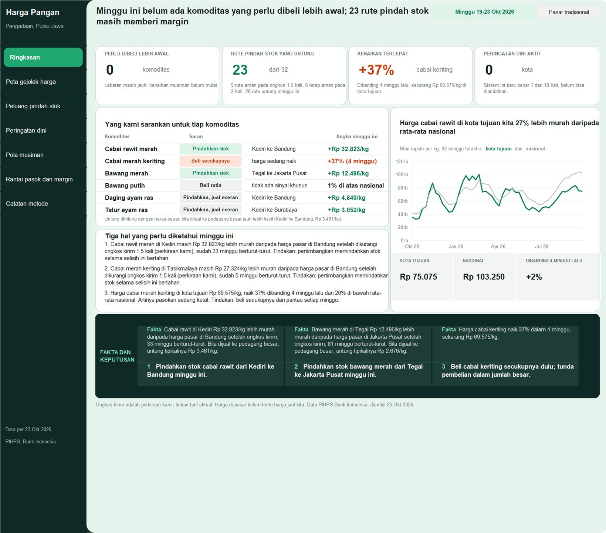

| Peta gejolak harga (pertanyaan 1) | Peluang pindah stok (pertanyaan 2) |
|---|---|
| 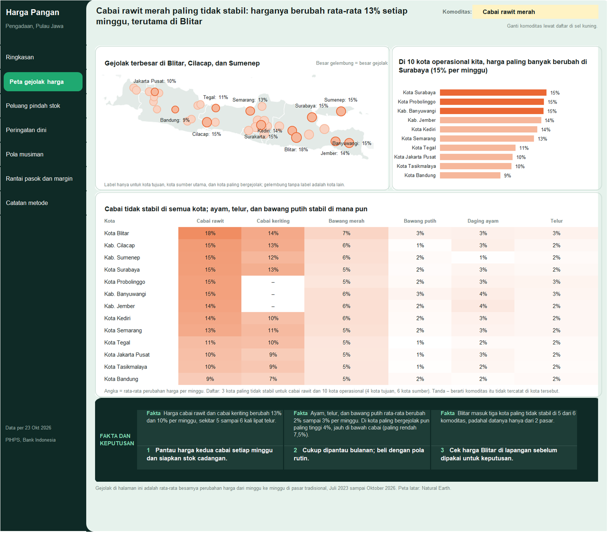 | 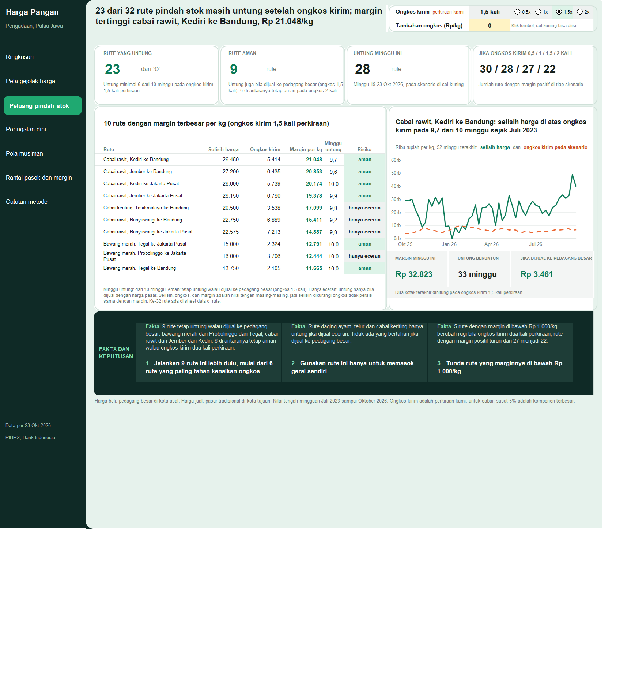 |
| **Peringatan dini (pertanyaan 3 dan 6)** | **Pola musiman (pertanyaan 4)** |
| 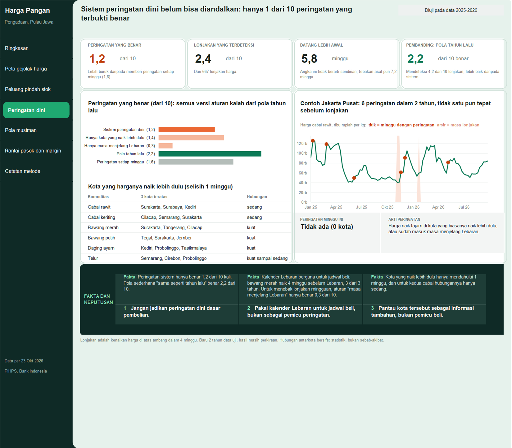 | 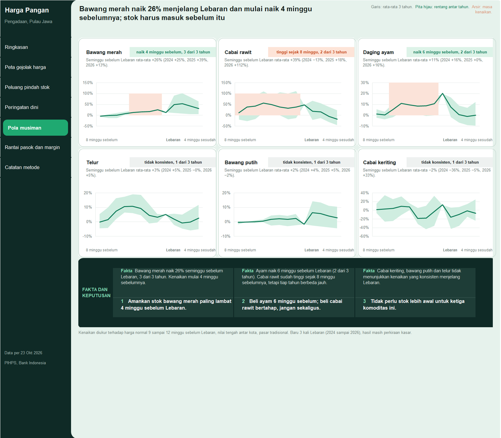 |
| **Rantai pasok dan margin (pertanyaan 5)** | |
| 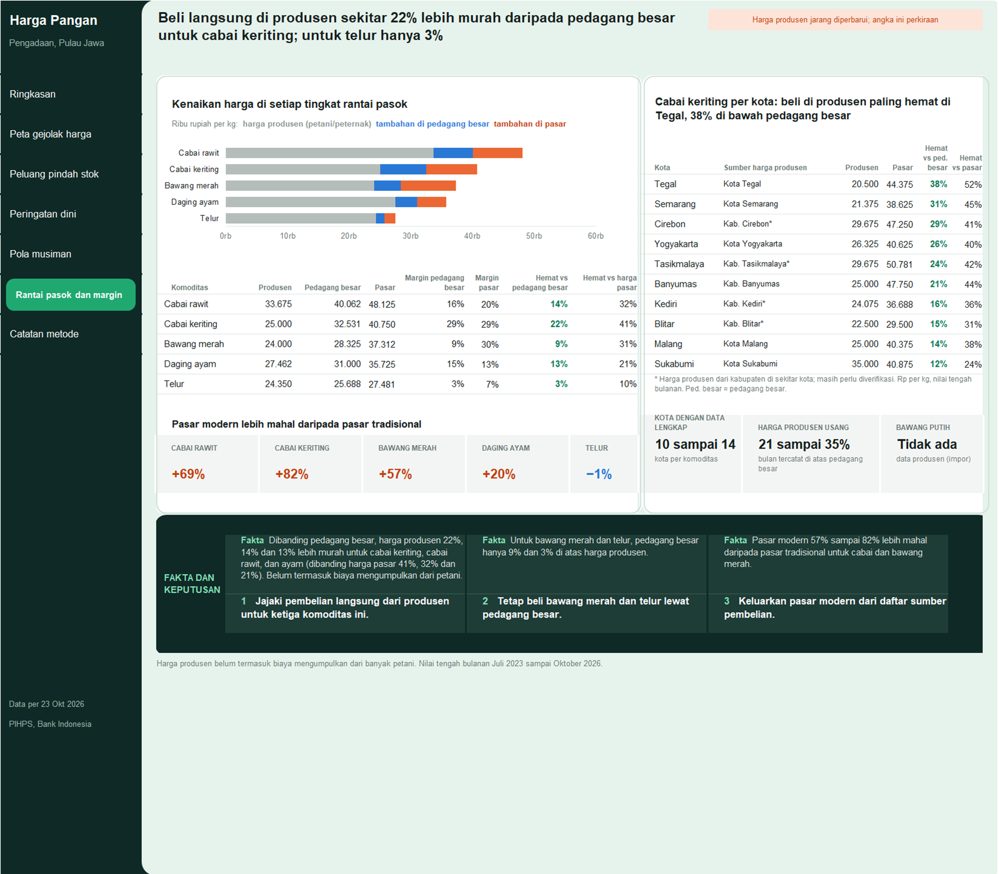 | |

- **Interaktif tanpa makro:** daftar pilihan komoditas (Peta gejolak harga), tombol pengali ongkos kirim 0,5 sampai 2 kali, dan
  sel input tambahan ongkos Rp/kg (Peluang pindah stok). Kartu, tabel rute terurut, judul, peta, dan grafik ikut berubah. Rumus
  memakai fungsi Excel klasik (SUMIFS, INDEX/MATCH, LARGE, SUMPRODUCT) supaya terbuka di Excel 2016 ke atas.
- **Bisa diaudit:** 20 angka kunci diberi nama sel (`kpi_*`). `src/audit_dashboard.py` menghitung ulang nilai acuan dari data
  dan membandingkannya dengan workbook: 20 dari 20 cocok, 0 rumus error, 0 istilah teknis di layar. Audit data terpisah
  menghitung ulang angka yang tampil langsung dari data olahan: 98 dari 98 cocok
  ([laporan audit data](docs/audit_data_dashboard_desain.md)).
- **Peta:** batas provinsi Natural Earth (domain publik) digambar sebagai latar, lalu grafik gelembung transparan ditumpuk
  dengan skala bujur dan lintang yang sama (`src/peta_jawa.py`).
- Cara membangun, memakai, dan mengaudit: [`excel/panduan.md`](excel/panduan.md). Padanan istilah teknis dan bahasa
  dashboard: [`excel/glosarium.md`](excel/glosarium.md).

## Analisis di balik dashboard

Ini proyek Data Analyst end-to-end: data diambil dari situs PIHPS dengan Python, dibersihkan, dianalisis, lalu diringkas menjadi
dashboard dan memo. Setiap pertanyaan punya skrip di `src/analysis/`, notebook penjelas di `notebooks/`, dan laporan di
`reports/`. Grafik di bawah dibuat otomatis oleh skrip analisis.

| 1. Gejolak harga per komoditas | 2. Rute yang masih untung setelah ongkos kirim |
|---|---|
| 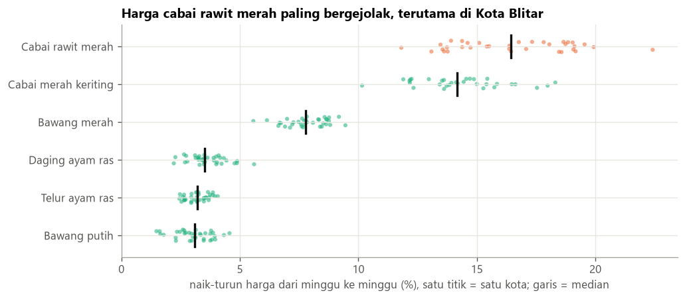 | 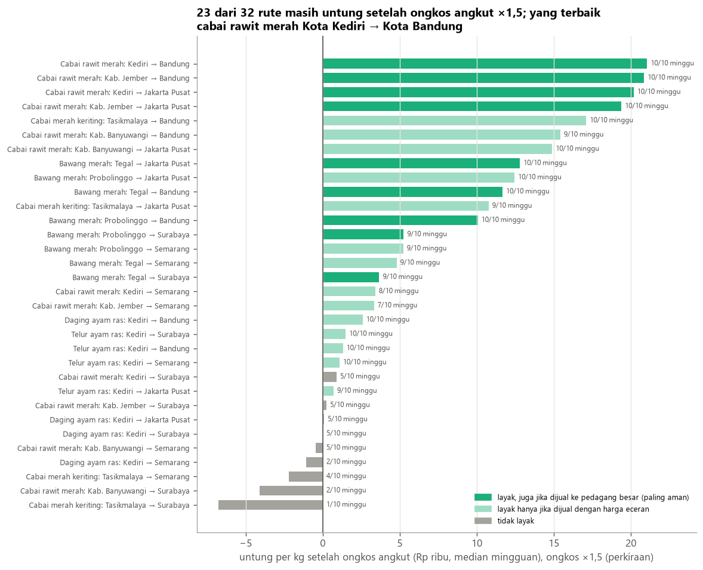 |
| [`reports/q1_gejolak.md`](reports/q1_gejolak.md) | [`reports/q2_rute.md`](reports/q2_rute.md) |
| **3. Kota yang harganya naik lebih dulu** | **4. Pola harga sekitar Idulfitri** |
| 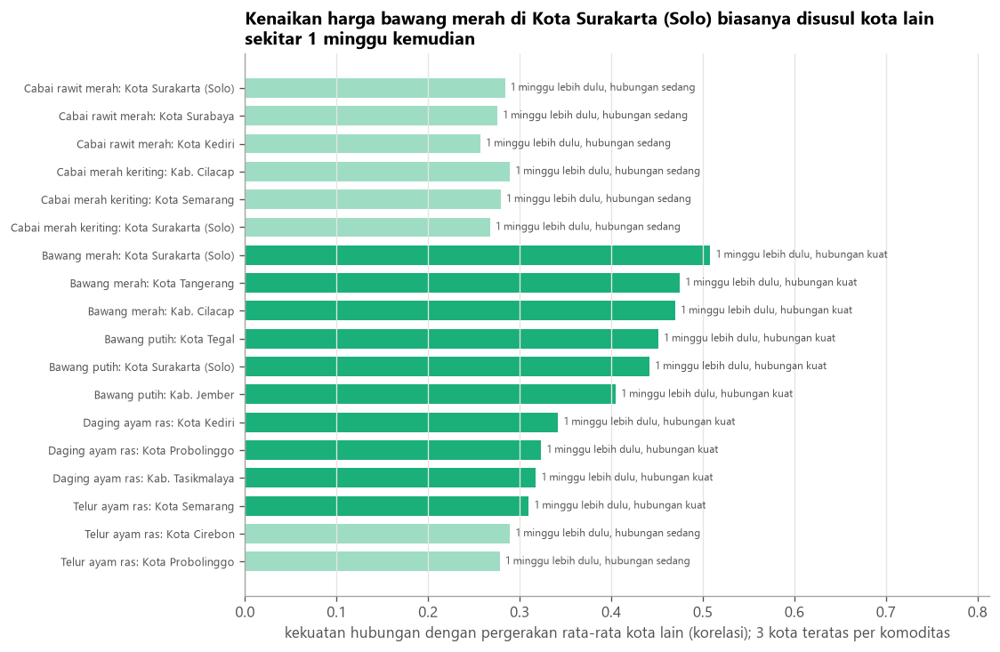 | 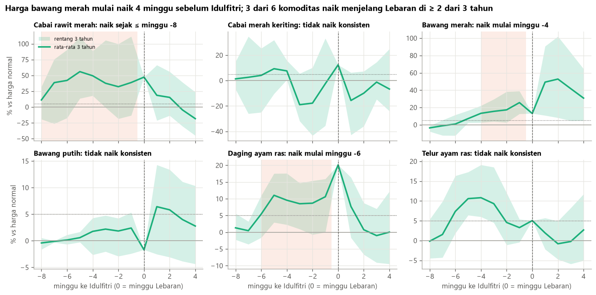 |
| [`reports/q3_kota_penentu_arah.md`](reports/q3_kota_penentu_arah.md) | [`reports/q4_pola_idul_fitri.md`](reports/q4_pola_idul_fitri.md) |
| **5. Tambahan harga di tiap tingkat rantai pasok** | **6. Hasil uji peringatan dini** |
| 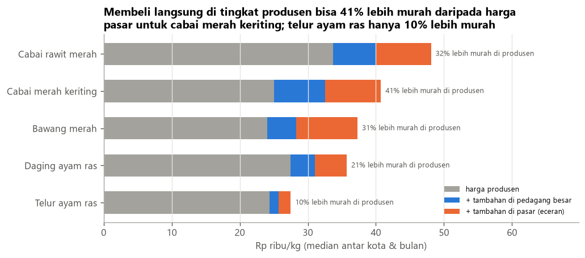 | 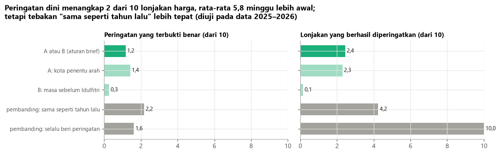 |
| [`reports/q5_margin.md`](reports/q5_margin.md) | [`reports/q6_peringatan_dini.md`](reports/q6_peringatan_dini.md) |

## Alur kerja

```
1. src/acquire.py           akuisisi sopan: jeda 2 detik, retry, cache, log per permintaan (960 file)
2. src/clean.py             format panjang, hari libur, celah sampai 5 hari, salah input dua tingkat   -> data/interim/
3. src/features.py          harga mingguan, perubahan, z-score tanpa melihat masa depan, minggu ke Idulfitri
4. src/logistics.py         ongkos kirim per rute (ASUMSI berlabel, dengan sumber tiap angka)
5. src/analysis/*.py        Q1 gejolak, Q2 rute, Q3 kota penentu arah, Q4 pola Idulfitri, Q5 margin, Q6 peringatan dini
6. src/insights.py          kalimat temuan dan daftar tindakan minggu ini; setiap kalimat menyimpan angka asalnya
7. src/export_dashboard.py  star schema (19 tabel, parquet dan csv)                                    -> data/processed/
8. src/build_excel_desain.py, recalc_excel.py, audit_dashboard.py, screenshot_excel.py                -> excel/
```

Notebook `notebooks/01` sampai `09` menjelaskan *kenapa* di tiap tahap (EDA, cleaning, fitur, lalu satu notebook per
pertanyaan). Notebook memanggil fungsi di `src/`, jadi tidak ada logika ganda.

## Metode (istilah teknis)

- **Data:** endpoint JSON `GetGridDataKomoditas` situs PIHPS ([`docs/data_access.md`](docs/data_access.md)); hanya hari
  kerja. Data diambil sampai H-2 karena BI bisa merevisi angka.
- **Cleaning:** hari libur nasional yang diisi harga hari sebelumnya dikosongkan; celah sampai 5 hari kerja diisi maju dan
  ditandai `is_imputed`; outlier dua tingkat (rasio ekstrem minimal 3 kali dan lintas kota minimal 5 kali dikosongkan;
  lonjakan tajam rolling median dan MAD hanya ditandai), dihitung dari harga asli. Laporan:
  [`docs/cleaning_report.md`](docs/cleaning_report.md).
- **Mingguan (W-FRI):** pasar tradisional = median hari kerja; pedagang besar, modern, produsen = nilai nyata terakhir
  minggu itu (pedagang besar praktis hanya diperbarui hari Kamis, jadi median akan memberi harga minggu lalu).
- **Q1:** simpangan baku log-return mingguan dan rata-rata besarnya perubahan persen mingguan per kota dan komoditas.
  Dashboard memakai rata-rata perubahan supaya angka kota sama ukurannya dengan angka komoditas.
- **Q2:** `spread_bersih = harga_tujuan (tradisional) - harga_sumber (pedagang besar) - ongkos - susut`; rute layak bila
  median positif dan untung minimal 60% minggu pada ongkos 1,5 kali; sensitivitas 0,5, 1, 1,5, dan 2 kali; uji ketahanan
  dengan harga pedagang besar di kota tujuan, juga pada ongkos 2 kali.
- **Q3:** korelasi silang log-return setelah prewhitening AR(4) (tanpa ini momentum bersama memunculkan "pemimpin" semu),
  kota dibanding rata-rata kota lain, jeda 1 sampai 4 minggu, koreksi Benjamini-Hochberg; Granger hanya pendukung, dan
  Granger bukan kausalitas.
- **Q4:** event study minggu -8 sampai +4 relatif terhadap baseline minggu -12 sampai -9, per tahun dan rentangnya.
- **Q5:** median bulanan produsen, pedagang besar, dan pasar, hanya kota dengan ketiga tingkat (sebagian dipasangkan dengan
  kabupaten sentra di sekitarnya). Hemat dibanding pedagang besar = 1 - 1 / (1 + tambahan harga di pedagang besar).
- **Q6:** lonjakan = kenaikan 4 minggu minimal persentil 90 (dipelajari dari data latih); alert = z-score kenaikan mingguan
  di atas 2 di kota penentu arah ATAU jendela sebelum Idulfitri; backtest latih sampai tahun T, uji tahun T+1 (2025, 2026);
  pembanding seasonal naive dan "selalu peringatkan".
- **Audit:** 11 angka kunci analisis dihitung ulang secara independen ([`docs/audit_analisis.md`](docs/audit_analisis.md)),
  begitu juga angka yang tampil di dashboard ([`docs/audit_data_dashboard_desain.md`](docs/audit_data_dashboard_desain.md)).

## Batasan

- **Ongkos kirim adalah asumsi, bukan data observasi** ([`config/biaya_logistik.yaml`](config/biaya_logistik.yaml)),
  karena itu diuji pada 0,5 sampai 2 kali perkiraan.
- Sampel PIHPS kecil (2 pasar dan 2 pedagang per kota), sehingga harga harian berisik.
- Harga eceran belum tentu harga yang bisa didapat distributor; volume dan ketersediaan stok tidak diketahui.
- Kota yang harganya naik lebih dulu adalah asosiasi statistik, bukan bukti sebab-akibat.
- Data bisa direvisi oleh BI. Data di repo ini diambil **25 Oktober 2026** (data terakhir 23 Oktober 2026).
- Pola Idulfitri baru dari 3 kali Lebaran (2024 sampai 2026); kota sumber dipilih dari pengetahuan umum tentang sentra
  produksi; sebagian harga produsen berasal dari kabupaten sekitar yang belum diverifikasi.

## Menjalankan ulang

Python 3.12, Windows untuk langkah Excel (hitung ulang dan screenshot memakai Excel lewat pywin32).

```bash
python -m venv .venv
.venv/Scripts/python -m pip install -r requirements.txt
.venv/Scripts/python -m pytest -q
```

```bash
python -m src.acquire            # data/raw/ (tidak disimpan di repo; sekitar 47 menit, jeda 2 detik antar permintaan)
python -m src.clean
python -m src.features
python -m src.logistics
python -m src.analysis.volatility    # lalu spread, leadlag, seasonality, margin, early_warning
python -m src.export_dashboard
python -m src.peta_jawa              # sekali: batas provinsi untuk peta
python -m src.build_excel_desain
python -m src.recalc_excel excel/Dashboard_pangan.xlsx
python -m src.audit_dashboard --xlsx excel/Dashboard_pangan.xlsx
python -m src.screenshot_excel_desain
```

Semua parameter (komoditas, kota, periode, ambang) ada di [`config/config.yaml`](config/config.yaml).

## Struktur repo

```
config/          parameter analisis dan asumsi ongkos kirim (berlabel ASUMSI)
data/processed/  star schema siap dashboard (parquet dan csv)
data/reference/  hari besar (terverifikasi SKB), koordinat kota, batas provinsi untuk peta, jarak dan ongkos per rute
docs/            akses data, profil data, laporan cleaning, fitur, ongkos, export, dan audit
src/             akuisisi, cleaning, fitur, analisis Q1 sampai Q6, insights, export, dashboard Excel
notebooks/       01_eda sampai 09_q6: narasi analisis
reports/         laporan per pertanyaan (q1 sampai q6), tabel, grafik, memo rekomendasi
excel/           Dashboard_pangan.xlsx, panduan, glosarium, screenshot
tests/           pytest untuk tiap tahap
```

Sumber data: PIHPS Nasional, Bank Indonesia, https://www.bi.go.id/hargapangan
